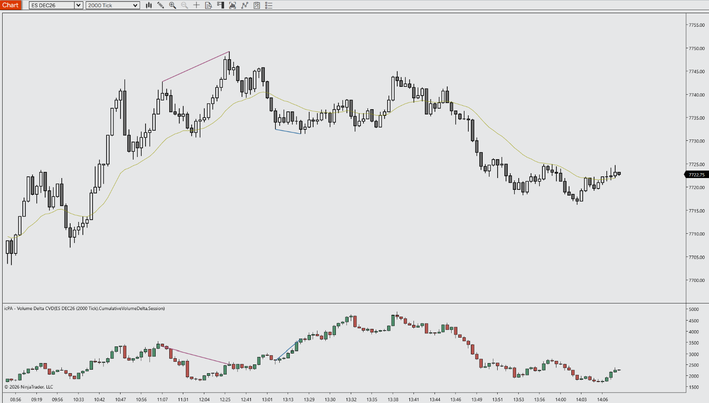
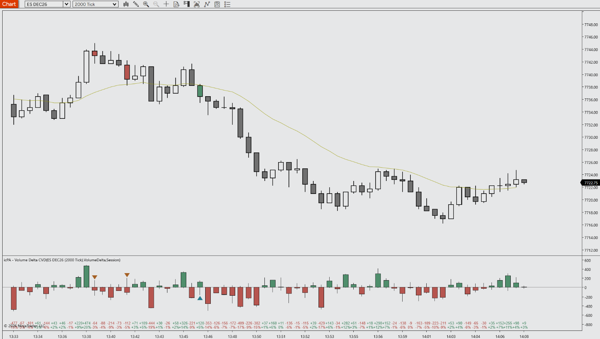

# icPA - Volume Delta CVD for NinjaTrader 8

A specialized Indicator engineered for Price Action day trading. It plots tick-accurate per-bar Volume Delta or Cumulative Volume Delta (CVD) in its own panel, built from a hidden 1-tick series, so no Tick Replay is required.

---

## 📺 Video Walkthrough & Setup

Watch the complete breakdown of parameters, price action context, and chart examples on YouTube:

> **[▶ Click here to watch the full YouTube walkthrough](https://youtube.com/@icPriceAction)**

---

## ⚡ Key Features

- **Delta & CVD Candles or Line:** Each trade is classified as buying or selling at the bid/ask (falling back to the tick rule inside the spread or without quotes). The panel then plots per-bar delta or running CVD as candles with intrabar high/low, or CVD as a line. An optional EMA/SMA signal line and zero line can be added. CVD resets per session, daily at a set time, weekly, at an anchor time, or never.
- **Order Flow Context Marks:** These cover delta flips (delta crossed zero within the bar and closed on the other side), delta / delta % / buy-sell labels under each bar, and optional price-bar coloring by delta. Divergences between price swings and CVD can be drawn on the price panel and/or the indicator panel.
- **Real-Time Alerts & Strategy Access:** Alerts are available for divergences, delta flips, CVD zero crosses, signal line crosses and an intrabar bar-delta threshold. Public data series (Delta, Cvd, BuyVolume, SellVolume, DeltaPercent, DeltaFlip, DivergenceSignal and more) can be read from your own strategies and indicators.
- **PATS & Context Aligned:** Designed for Price Action principles (Mack / Thomas Wade) and disciplined futures execution.
- **Zero Chart Lag:** Native C# execution optimized to prevent UI freezes on high-frequency 2000-tick ES/MES charts.
- **Clean Visuals:** Complementary default palette that preserves candlestick clarity without chart clutter.
- **Fully Customizable:** Configure colors, thresholds, offsets, and alerts via the native NT8 settings panel.

---

## ⚠️ Prerequisites & Data Requirements

- **No Tick Replay required.** The indicator adds its own 1-tick data series. It also works with Tick Replay enabled, but loads more slowly.
- **Calculate mode** is forced to **On Each Tick** automatically.
- **Load chart data by Days** (not by number of Bars), so the 1-tick series covers the full chart history.
- **Enable "Break at EOD"** on Tick, Volume, Range and other non-time-based charts. A one-time warning is printed to the Output window if it is off. Minute, Second and Day-based charts work without it.
- **Historical accuracy depends on your data provider** supplying historical bid/ask for tick data. Enable **Print Diagnostics** to see how many historical trades were classified by bid/ask versus the tick rule. Real-time delta is unaffected.
- Works on any instrument with 1-tick data; built and tested for ES/MES/NQ/MNQ futures.

---

## 📥 Installation Guide

1. Head to the **[Releases](https://github.com/icPriceAction/volume-delta-cvd/releases)** tab of this repository.
2. Download the latest release `.zip` file (`icPriceAction_icPAVolumeDeltaCVD_v2.4.3.zip`).
   - *Note: Do NOT extract or unzip the file.*
3. Open **NinjaTrader 8**.
4. In the Control Center, navigate to:
   `Tools` ➔ `Import` ➔ `NinjaScript Add-On...`
5. Select the downloaded `.zip` file and click **Open**.
6. A success dialog will appear confirming the tool has been imported.
7. Open any chart, press `Ctrl + I`, find **icPA - Volume Delta CVD** in the **icPA** folder, and add it.

---

## ⚙️ Parameters & Configuration

| Parameter | Group | Type | Default | Description |
| :--- | :--- | :--- | :--- | :--- |
| Indicator Mode | 1. General | Enum | Volume Delta | Volume Delta: delta per bar. Cumulative Volume Delta: running total of delta since the last reset. |
| CVD Display Style | 1. General | Enum | Candlestick | Draw CVD as candlesticks (with intrabar high/low) or as a line. Ignored in Volume Delta mode. |
| Min Trade Size | 1. General | Integer (≥ 1) | 1 | Only trades of at least this many contracts count toward delta and CVD. 1 = all trades. |
| CVD Reset Mode | 1. General | Enum | Session | When CVD returns to zero: Session, Daily At Time, Weekly, Anchor, or Never. |
| CVD Reset Time | 1. General | Time | 09:30 | Time of day for "Daily At Time" (weekdays only), in the Reset Time Zone. |
| CVD Reset Time Zone | 1. General | Enum | Eastern | Time zone for Reset Time and Anchor Time (Eastern, Central, Pacific, London, Central Europe, Tokyo, Hong Kong, Sydney, UTC, Exchange, Platform). Daylight saving is handled automatically. |
| CVD Anchor Time | 1. General | Date/Time | Today 09:30 | Date and time for "Anchor" reset mode, in the Reset Time Zone. |
| Signal Type | 1. General | Enum | EMA | Exponential (EMA) or simple (SMA) moving average for the signal line and signal cross alerts. |
| Signal Period | 1. General | Integer (1–1000) | 20 | Number of bars in the signal line moving average. |
| Print Diagnostics | 1. General | Boolean | False | After loading, print data-quality stats (trade classification, mapping) to the Output window. |
| Candle Up Color | 2. Visuals | Brush | #4C8C6A | Body color when the bar closes above its open. Also used for positive labels. |
| Candle Down Color | 2. Visuals | Brush | #B5524C | Body color when the bar closes below its open. Also used for negative labels. |
| Candle Outline Color | 2. Visuals | Brush | Black | Color of wicks and body outlines. |
| Candle Outline Width | 2. Visuals | Integer (1–10) | 1 | Width of wicks and body outlines. |
| CVD Line Color | 2. Visuals | Brush | #111213 | Used when CVD Display Style is Line. |
| CVD Line Width | 2. Visuals | Integer (1–10) | 2 | Used when CVD Display Style is Line. |
| CVD Line Style | 2. Visuals | Dash Style | Solid | Used when CVD Display Style is Line. |
| Show Signal Line | 2. Visuals | Boolean | False | Moving average of the displayed Delta or CVD. Color and width are set under Plots > Signal (default #C08A2E). |
| Show Zero Line | 2. Visuals | Boolean | True | Horizontal line at zero, drawn behind the candles. |
| Zero Line Color | 2. Visuals | Brush | DimGray | Color of the zero line. |
| Zero Line Width | 2. Visuals | Integer (1–10) | 1 | Width of the zero line. |
| Show Delta Flips | 2. Visuals | Boolean | False | Mark candles where delta crossed zero within the bar and closed on the other side. |
| Bullish Flip Color | 2. Visuals | Brush | #1F7A8C | Marker below candles that flipped from negative to positive delta. |
| Bearish Flip Color | 2. Visuals | Brush | #A35C1F | Marker above candles that flipped from positive to negative delta. |
| Label Content | 2. Visuals | Enum | None | Text under each bar: None, Delta, Delta Percent, Delta And Percent, or Buy/Sell Volume. Hidden automatically when bars are too close to fit it. |
| Label Font | 2. Visuals | Font | Arial 10 | Font for the bar labels. |
| Color Price Bars | 2. Visuals | Enum | Off | Color the main chart's bars by delta sign, by delta % beyond the threshold, or on flip bars only. |
| Price Bar Up Color | 2. Visuals | Brush | #4C8C6A | Price bar color for positive delta conditions. |
| Price Bar Down Color | 2. Visuals | Brush | #B5524C | Price bar color for negative delta conditions. |
| Show Divergences | 2. Visuals | Boolean | False | Draw divergences between price swings and CVD. Detection always runs for alerts and strategies. |
| Divergences On Price Panel | 2. Visuals | Boolean | True | Draw divergence lines on the price panel (the most recent 500 are kept). |
| Divergences On Indicator Panel | 2. Visuals | Boolean | True | Draw divergence lines in the indicator panel. Only drawn when the panel shows CVD. |
| Bullish Divergence Color | 2. Visuals | Brush | #2F6FA3 | Price lower low with CVD higher low. |
| Bearish Divergence Color | 2. Visuals | Brush | #9C4A7A | Price higher high with CVD lower high. |
| Divergence Line Width | 2. Visuals | Integer (1–10) | 2 | Width of divergence lines on both panels. |
| Flip Min Extreme | 3. Offsets & Thresholds | Number (≥ 0) | 100 | How far (in contracts) delta must reach on the opposite side before a flip counts. Scale to instrument and bar size. |
| Delta % Threshold | 3. Offsets & Thresholds | Number (0–100) | 20 | Minimum delta, as % of the bar's volume, for "Delta Percent Threshold" price bar coloring. |
| Swing Strength | 3. Offsets & Thresholds | Integer (1–50) | 5 | Bars needed on each side to confirm a swing. Divergences appear this many bars after the swing. |
| Max Bars Between Swings | 3. Offsets & Thresholds | Integer (2–1000) | 60 | Swings further apart than this are not compared for divergences. |
| Enable Alerts | 4. Alerts | Boolean | False | Real-time only. Alerts appear in the Alerts Log and play the Alert Sound. |
| On Divergence | 4. Alerts | Boolean | True | Alert when a divergence is confirmed. |
| On Delta Flip | 4. Alerts | Boolean | False | Alert at bar close on a delta flip. |
| On CVD Zero Cross | 4. Alerts | Boolean | False | Alert at bar close when CVD crosses zero. The drop to zero caused by a reset is ignored. |
| On Signal Line Cross | 4. Alerts | Boolean | False | Alert at bar close when Delta/CVD crosses its signal line. Works even if the signal line is hidden. |
| On Bar Delta Threshold | 4. Alerts | Boolean | False | Intrabar alert, at most once per bar, when \|delta\| reaches the threshold. |
| Bar Delta Threshold | 4. Alerts | Number (≥ 1) | 500 | Absolute bar delta, in contracts. |
| Alert Sound | 4. Alerts | Text | Alert2.wav | File in NinjaTrader's sounds folder or a full path. Empty = no sound. |

### Public data series (for your own strategies and indicators)

`DeltaOutput`, `Signal`, `BuyVolume`, `SellVolume`, `TotalVolume`, `Delta`, `DeltaHigh`, `DeltaLow`, `DeltaPercent`, `DeltaFlip` (+1 / -1 / 0), `Cvd`, `CvdOpen`, `CvdHigh`, `CvdLow`, `DivergenceSignal` (+1 / -1 / 0 on the confirmation bar).

Bars before the first full session are never set, so check `IsValidDataPoint` before use. When called from code, only Indicator Mode and CVD Reset Mode are constructor inputs; all other settings use their defaults.

---

## 📝 Changelog

- **v2.4.3** (2026-11-01) - Initial public release. Cleaned and optimized by icPriceAction.
- **v2.4.2**              - Properties regrouped in a logical order with consistent names and concise descriptions.
- **v2.4.1**              - Implementation notes moved into the file header; changelog added.
- **v2.4.0**              - Audit fixes: closed-bar evaluation one bar later, Calculate forced to On Each Tick, delta flips require a zero cross, unique alert IDs, per-trade delta-threshold alert, signal line in auto-scale, faster label measuring.
- **v2.3.0**              - CVD divergences (price and/or indicator panel), real-time alerts, DivergenceSignal public series.
- **v2.2.0**              - Min Trade Size filter, delta % of volume, delta flip markers, per-bar labels, price-bar coloring, TotalVolume/DeltaPercent/DeltaFlip series.
- **v2.1.1**              - Plot line explicitly hidden in candlestick modes.
- **v2.1.0**              - CVD reset modes with time zones, signal line (EMA/SMA), zero line, public data series.
- **v2.0.0**              - No Tick Replay required: trade-to-bar mapping rewritten, tick-rule fallback, cached SharpDX brushes, candle width follows chart zoom, diagnostics output.
- **v1.9.0**              - Original version: Volume Delta / CVD candles and CVD line from a 1-tick series.

---

## 🐛 Bug Reports & Feature Requests

Found an issue or have an enhancement idea?
Please submit an issue on the [Issues tab](https://github.com/icPriceAction/volume-delta-cvd/issues).

---

## License

Free for personal trading use. Commercial resale, redistribution, or repackaging is strictly prohibited. See [LICENSE](LICENSE).

---

## ⚖️ Disclaimer

Futures trading involves substantial risk of loss and is not suitable for every investor. All indicators, drawing tools, strategies, and documentation provided by **icPriceAction** are for educational and analytical purposes only. Nothing herein constitutes financial or investment advice. Automated strategies can lose money and may behave differently in live markets than in simulation or backtests.

NinjaTrader® is a registered trademark of NinjaTrader, LLC. icPriceAction is an independent developer with no official affiliation to NinjaTrader, LLC.